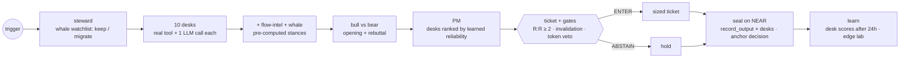
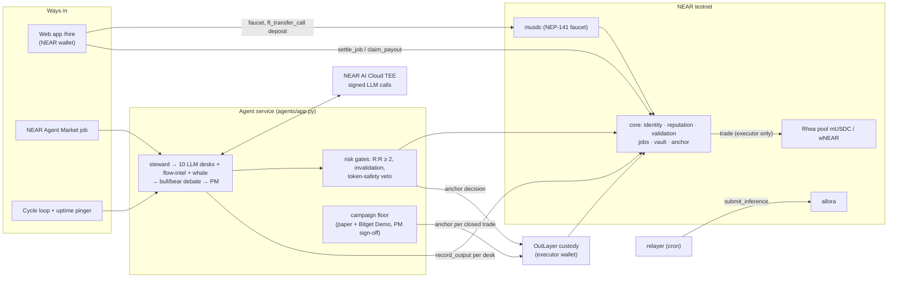

# HeliQuant

**An autonomous AI trading firm on NEAR — ten real-source desks debate, one PM decides, and every decision is checkable on-chain.**

NEAR testnet · NEAR AI Cloud (TEE-signed LLM calls) · OutLayer Agent Custody · NEAR Agent Market · Rhea · Allora

### **[▶ Open HeliQuant — heliquant-near.vercel.app](https://heliquant-near.vercel.app)**

[Hire the firm](https://heliquant-near.vercel.app/hire) · [TEE proofs](https://heliquant-near.vercel.app/proof) · [Live trading floor](https://heliquant-near.vercel.app/campaign) · [On-chain ledger](https://heliquant-near.vercel.app/ledger) · [The 13 agents](https://heliquant-near.vercel.app/agents) · [Run your own engine](https://heliquant-near.vercel.app/onboarding)

| Live | Link |
|---|---|
| Web app | [heliquant-near.vercel.app](https://heliquant-near.vercel.app) |
| Documentation | [heliquant-docs.vercel.app](https://heliquant-docs.vercel.app/docs) |
| Agent service (public read API) | https://agent-production-4fd0.up.railway.app |
| NEAR Agent Market listing | https://heliquant.market.near.ai |
| `core` contract | https://testnet.nearblocks.io/address/core.heliquant.testnet |
| Source code | https://github.com/ChristianBagas123/HeliQuant |

Everything runs on NEAR testnet, paper trading and the Bitget Demo account. No real money is used. Nothing here is financial advice.

## What is HeliQuant

An AI trading agent is usually a black box: one model, one answer, and a backtest you have to trust. HeliQuant is
built the other way round. It is a **firm** of AI agents, organised like a trading desk, and every step of a decision
leaves evidence you can check yourself:

- **Ten specialist desks** each read a different real data source, plus two data-driven voices (flow-intel and whale).
- A **bull** and a **bear** researcher debate the desk outputs; a **portfolio manager (PM)** decides `ENTER` or `ABSTAIN`.
- Deterministic code, not the LLM, computes entry, stop, targets and size, and **hard risk gates** can veto the PM.
- Every desk output is sealed on NEAR (`record_output`), every decision hash is anchored (`core.anchor`), and every
  LLM call of a cycle runs inside a **TEE** on NEAR AI Cloud and returns a signature you can verify.
- The executor that signs on-chain is an **OutLayer custody wallet**; the agent never holds that key.
- Anyone can **hire** the firm: per job on NEAR Agent Market, or with a test-token deposit into the `core` vault from the web app.

It abstains on purpose. The edge lab tested NEAR under a cost-aware out-of-sample gate and nothing passed, so the
validated-edge registry is empty and the PM holds. Publishing that is part of the product.

### The firm — ten real-source desks + two data voices → one PM

Each desk runs a real tool over fresh data (`agents/firm/organization.py · build_desks`), then one LLM call
interprets it into a stance. Each one is a registered, soulbound agent identity (NEP-171) in `core` with its own
NEAR sub-account and a key that can only call `record_output`.

| Token | Desk | Real source | Role | Account |
|---|---|---|---|---|
| 1 | **HeliQuant (firm)** | — | Firm — the identity that hire jobs and their reputation belong to | token 1 in [`core.heliquant.testnet`](https://testnet.nearblocks.io/address/core.heliquant.testnet), owned by [`heliquant.testnet`](https://testnet.nearblocks.io/address/heliquant.testnet) |
| 2 | **Regime / Technical** *(the ML)* | 1h exchange klines → features; rule-based live regime + ADX; XGBoost classifier (78.9% vs 76.1% persistence on NEAR) | Signal — regime, trend strength, dynamic R:R | [`regime.heliquant.testnet`](https://testnet.nearblocks.io/address/regime.heliquant.testnet) |
| 3 | **Macro (Allora)** | Allora chain LCD (BTC topic 14, ETH topic 9, 8h inference) + CoinGecko spot | Signal — decentralised-AI macro direction | [`macro.heliquant.testnet`](https://testnet.nearblocks.io/address/macro.heliquant.testnet) |
| 4 | **On-chain / Risk** | GeckoTerminal trades of 5 Rhea wNEAR pools + NEAR RPC token screen of `wrap.near` | Risk — whale flow vs price, token-safety veto | [`onchain-risk.heliquant.testnet`](https://testnet.nearblocks.io/address/onchain-risk.heliquant.testnet) |
| 5 | **Research** | alternative.me Fear & Greed + CoinGecko global, trending, prices | Research — market mood | [`research.heliquant.testnet`](https://testnet.nearblocks.io/address/research.heliquant.testnet) |
| 6 | **Smart-Money Flow** | Bitget perp OI / funding / long-short + Nansen smart-money netflow | Signal — positioning, contrarian to crowding | [`smart-money.heliquant.testnet`](https://testnet.nearblocks.io/address/smart-money.heliquant.testnet) |
| 7 | **Smart-Social** | Elfa (smart-account mentions, trending tokens, news) | Research — attention and narratives | [`smart-social.heliquant.testnet`](https://testnet.nearblocks.io/address/smart-social.heliquant.testnet) |
| 8 | **OI-Contrarian** | `validated_edges.json` + live OI-change quintile | Signal — acts only on a validated edge | [`oi-contrarian.heliquant.testnet`](https://testnet.nearblocks.io/address/oi-contrarian.heliquant.testnet) |
| 9 | **flow-intel** *(no LLM)* | Positioning history scored by the edge lab (OOS + FDR) | Signal — which flow signals actually validate | [`flow-intel.heliquant.testnet`](https://testnet.nearblocks.io/address/flow-intel.heliquant.testnet) |
| 10 | **whale** *(no LLM)* | Hyperliquid leaderboard + live positions of the top traders | Signal — what winning traders hold in the asset | [`whale.heliquant.testnet`](https://testnet.nearblocks.io/address/whale.heliquant.testnet) |
| 11 | **Carry** | Bitget funding rates vs risk-free | Signal — delta-neutral yield monitor (advisory) | [`carry.heliquant.testnet`](https://testnet.nearblocks.io/address/carry.heliquant.testnet) |
| 12 | **NEAR Fundamentals** | DeFiLlama NEAR TVL, fees, staking yields | Research — ecosystem risk-on / risk-off | [`near-fundamentals.heliquant.testnet`](https://testnet.nearblocks.io/address/near-fundamentals.heliquant.testnet) |
| 13 | **TimesFM Vol/Risk** | Realized vol → next-day forecast (Google TimesFM 2.5 when `TIMESFM_URL` is set, EWMA otherwise) | Risk — risk-off stance, ticket vol-sizing 0.5–1.25×, regime-break alarm | [`timesfm.heliquant.testnet`](https://testnet.nearblocks.io/address/timesfm.heliquant.testnet) |

### The decision loop



1. **Trigger.** The 30-minute cycle loop (an uptime pinger hits `/run-cycle`), an Agent Market job, or a manual call. The asset rotates through the basket BTC, ETH, SOL, HYPE, SUI, XRP, NEAR.
2. **Steward.** One LLM call reads a deterministic health report of the whale watchlist and decides `KEEP` or `MIGRATE` (re-scan the Rhea pools).
3. **Desks.** The ten tools run on fresh data; each desk makes one LLM call on NEAR AI Cloud (`Qwen/Qwen3.8-27B`, TEE) and returns `{stance, confidence, key_point}`. flow-intel and whale add their stances without an LLM.
4. **Debate.** Bull and bear each open and then rebut (4 calls, `z-ai/glm-5.3-flash` with a reasoning budget).
5. **PM.** Reads the desks ranked by learned reliability (weights 0.6–1.4), the debate, memory of past decisions and advisory briefs, and decides `ENTER` (only on a validated edge) or `ABSTAIN`.
6. **Ticket and gates.** `finalize_decision` builds the ticket in code: entry zone, structural stop, invalidation, take-profit ladder, size. It must clear R:R ≥ 2 and the token-safety veto; the PM gets at most two repair attempts, then the decision becomes `ABSTAIN`.
7. **Seal.** Each desk key calls `record_output`; the executor anchors the decision hash with `core.anchor`; the record carries the cycle's TEE proof summary and is written to Supabase.
8. **Learn.** Desk stances are scored against the realized move after 24 hours; the edge lab re-validates edges every cycle and promotes or demotes them on evidence.

One cycle makes **16 LLM calls** (steward, 10 desks, 4 debate calls, PM), all TEE-signed: `GET /tee` shows `n_calls` and `n_verified`.

## Features

| Feature | What it does | Code |
|---|---|---|
| **Verifiable decisions** | Every decision hash is anchored as a NEP-297 event; every desk output is sealed as a validation credential against its agent token | `agents/firm/onchain_recorder.py`, `agents/firm/agent_onchain.py`, `contracts/core/src/anchor.rs`, `validation.rs` |
| **TEE-signed LLM calls** | Each call runs on NEAR AI Cloud inside a TEE and returns an ed25519 signature over `model:request_hash:response_hash`. Bundles are public at `/tee`, checkable with `verify_tee.py` and on `/proof`. A fallback call to Groq is marked unverified | `agents/firm/tee.py`, `agents/scripts/verify_tee.py` |
| **Custody executor** | `trade` and `anchor` are signed inside OutLayer's TEE under the owner's policy; the agent holds only an API key. A restricted function-call key is the rollback path | `agents/firm/executor_signer.py` |
| **Hire on NEAR Agent Market** | A job brief like `Analyze NEAR` returns a Markdown deliverable: decision, ticket, every desk vote, the anchor transaction and the TEE proofs | `agents/firm/market_worker.py` |
| **Hire into the on-chain vault** | From `/hire`: faucet mUSDC, deposit with `ft_transfer_call` (duration 1 hour, 1 day or 7 days; 20% performance fee on profit, contract maximum 30%), settle after maturity, claim a failed payout. Only the executor can trade a job, only between mUSDC and wNEAR on the Rhea pool, only from that job's balance | `frontend/src/app/hire`, `contracts/core/src/job.rs`, `vault.rs` |
| **Reputation** | Settling a job records its PnL in the firm's on-chain reputation | `contracts/core/src/reputation.rs` |
| **Risk engine** | SAFE sizing 0.5–1.5% risk by conviction; AGGRESSIVE quarter-Kelly capped at 3% risk and 5× leverage, only with a validated edge (≥ 20 trades); 20% drawdown breaker; volatility scaling 0.5–1.25× | `agents/firm/trade_ticket.py` |
| **Edge lab** | A hypothesis must beat zero and buy-and-hold and clear a ~20 bps round-trip cost out-of-sample, with ≥ 20 trades, Benjamini–Hochberg FDR and a 5-fold walk-forward with an outlier check | `agents/firm/edge_lab.py`, `agents/scripts/59_onboard_asset.py`, `60_self_learn.py` |
| **Self-learning** | Desk reliability weights from realized outcomes; edges promoted or demoted on new data; the floor learns per condition and per asset, and scores the trades it declined | `agents/firm/desk_performance.py`, `edge_lab.py`, `campaign.py` |
| **Campaign floor** | A continuous paper trader at live prices: deterministic desk votes → ordered gates (macro event-risk, cold-asset bench, mid-range chop, clear trend, TradingView 1h vs 1D, whale veto, over-extension) → one LLM PM sign-off. NEAR, BTC, ETH and XRP also fill on Bitget Demo; every closed trade is anchored | `agents/firm/campaign.py`, `pm_signoff.py` |
| **Token-safety veto** | An internal NEAR token screen (holders, liquidity) turns `ENTER` into `ABSTAIN` when it fails or cannot run | `agents/firm/sources/rugpull.py` (`security_gate`), `campaign.py` (`_security_ok`) |
| **Run your own engine** | `agents-LocalReady` runs the firm on your machine; the web app registers your API keys on it after a NEP-413 signature from `HQ_OWNER_ACCOUNT` | `agents-LocalReady/`, `agents/firm/nep413.py` |
| **Allora relay** | A Railway cron copies the Allora BTC 8h inference into the `allora` contract every 30 minutes | `relayer/allora_relayer.py` |
| **Cost guard** | `NEARAI_BUDGET_USD` (default 8) stops TEE inference in code; measured about $0.0077 per cycle | `agents/firm/tee.py` |

## On-chain footprint (NEAR testnet)

Every address below opens on NearBlocks.

| What | Account | Notes |
|---|---|---|
| `core` contract | [`core.heliquant.testnet`](https://testnet.nearblocks.io/address/core.heliquant.testnet) | Agent identity (NEP-171, soulbound), reputation, validation credentials, jobs, vault, anchor. `nft_total_supply` = 13 |
| `musdc` contract | [`musdc.heliquant.testnet`](https://testnet.nearblocks.io/address/musdc.heliquant.testnet) | Mock USDC (NEP-141, 6 decimals) with a public faucet — the hire deposit token |
| `allora` contract | [`allora.heliquant.testnet`](https://testnet.nearblocks.io/address/allora.heliquant.testnet) | Allora BTC predictions pushed by the relayer |
| Executor (OutLayer custody) | [`3c3f177f…21104e`](https://testnet.nearblocks.io/address/3c3f177f15b03d76320aee0eed025c0fa4af1ac03d4c5f6cf8d69c3d8f21104e) | The only account `core` accepts `trade`, `recover_job`, `reconcile_job` and `anchor` from |
| Relayer | [`relayer.heliquant.testnet`](https://testnet.nearblocks.io/address/relayer.heliquant.testnet) | Key limited to `submit_inference` on `allora` |
| Parent account | [`heliquant.testnet`](https://testnet.nearblocks.io/address/heliquant.testnet) | Owner of the contracts and sub-accounts |
| DEX | [`ref-finance-101.testnet`](https://testnet.nearblocks.io/address/ref-finance-101.testnet) | Rhea (Ref Finance) testnet, pool `2926` (mUSDC / `wrap.testnet`) |
| First anchor | [`HWo1NgDK…fhgep`](https://testnet.nearblocks.io/txns/HWo1NgDKkJNgpMd9oXHf6zPUZYEGtD8NNzimUfBAhgep) | Block 276,890,553, 2026-11-09 — the deploy smoke test, not a trading decision |

The twelve desk accounts are in the desk table above. Deployed Wasm hashes are in `contracts/deployments/near_testnet.json`.

## Try it

Each step says what to do and what you should see.

1. **Hire the firm on Agent Market.** Open the listing, hire it with the brief `Analyze NEAR` (price $0.01 per call). You should receive a Markdown deliverable within the 20-minute SLA containing the decision, the trade ticket if there is one, every desk's vote, the `core.anchor` transaction and a "TEE proof" section.
2. **Look at the latest TEE proofs.** `GET https://agent-production-4fd0.up.railway.app/tee?limit=1` returns the newest cycle. You should see `n_calls` 16 and `n_verified` 16.
3. **Verify a cycle yourself.** With `requests` and `pynacl` installed:
   ```bash
   python agents/scripts/verify_tee.py --url https://agent-production-4fd0.up.railway.app/tee/<cycle_id>
   ```
   Every line should print `OK`. Add `--fresh-attestation` to also fetch a new attestation report and check that the signers are still attested.
4. **See the same proofs in the browser.** Open `/proof` on the web app. It lists recent cycles, the per-call table and the command above.
5. **Check the executor.** Open the executor link above. The `anchor` and `trade` transactions are signed by that implicit account, which is the OutLayer custody wallet. `GET <agent>/health/onchain` shows the executor with `mode: custody`.
6. **Hire through the contract.** On `/hire` connect a testnet wallet, take mUSDC from the faucet, open a job, then settle it. You should see `job_created`, then a payout when settled.
7. **Check the desk keys.** `GET <agent>/health/onchain` lists each desk key with its remaining allowance and status. Each desk key can only call `record_output` on `core`.

## Architecture

Three ways in, one firm, one contract.



| Flow | What happens | Where |
|---|---|---|
| **Hire from the web app** | Connect a testnet wallet on `/hire`, take mUSDC from the faucet, deposit it into `core` with `ft_transfer_call` (event `job_created`; a bad deposit is refunded with `job_rejected`). Only the executor account can `trade` the job's funds through the Rhea pool. After the job's end time anyone can call `settle_job`; the payout goes to the client, or becomes claimable with `claim_payout` if the transfer fails. Settlement records the job's result in the firm's reputation | `frontend/src/app/hire`, `contracts/core/src/job.rs`, `contracts/core/src/vault.rs` |
| **Trades on a hired job** | The agent does not call `trade` on its own. The executor trades a job with `agents/scripts/executor_demo.py` (buy or sell a share of the job balance, `min_amount_out` from the Rhea quote) and recovers a stuck job with `recover_job` / `reconcile_job` | `agents/scripts/executor_demo.py`, `agents/firm/executor_signer.py` |
| **Hire on NEAR Agent Market** | The worker polls assignments, runs one analysis of the asset in the brief, anchors the decision and submits a Markdown deliverable with the TEE proofs. A job includes up to 2 rounds of changes, each a fresh analysis; after that the latest report is re-submitted. No user funds move | `agents/firm/market_worker.py` |
| **Cycle loop** | Every `INTERVAL_MIN` (default 30) the firm analyses the next asset of the basket, seals each desk output with `record_output`, anchors the decision and writes it to Supabase | `agents/app.py`, `agents/firm/organization.py` |
| **Campaign floor** | Opens and closes small positions from deterministic desk votes after an ordered gate stack and a one-call LLM PM sign-off. Paper at live prices; NEAR, BTC, ETH and XRP also fill on Bitget Demo. Each closed trade is anchored | `agents/firm/campaign.py`, `agents/firm/pm_signoff.py` |
| **Your own engine** | `agents-LocalReady` runs the same agent on your machine. The web app registers your API keys on it after a NEP-413 signature from `HQ_OWNER_ACCOUNT` (see below) | `agents-LocalReady/`, `agents/firm/nep413.py` |
| **Allora relay** | A cron reads the Allora BTC prediction from the Allora chain and submits it to the `allora` contract | `relayer/` |

## Repository layout

```
HeliQuant/
├── agents/                 Python 3.12 agent service (FastAPI) — the firm
│   ├── app.py              cycle loop, campaign floor driver, public API, NEP-413 onboarding
│   ├── firm/               organization (desks, debate, PM), trade_ticket, campaign, edge_lab, tee,
│   │                       nep413, executor_signer, near_client, market_worker, data clients
│   ├── scripts/            research, edge lab, deploy helpers, verify_tee.py, executor_demo.py
│   ├── data/ · models/     market data, edge registry, agent registry, regime model
│   ├── DEPLOY.md           Railway deploy and every environment variable
│   ├── README.md           agent overview
│   └── BACKTEST.md         edge-lab results on NEAR
├── contracts/              Rust (near-sdk 5.30.1): core, musdc, allora + build and deploy scripts
├── relayer/                Allora → NEAR relayer (Railway cron)
├── frontend/               Next.js 16 web app (near-connect-hooks wallet)
├── agents-LocalReady/      run your own engine (Docker or venv)
├── docs/                   documentation site (Fumadocs)
└── Findings/               19 measured findings, each with its source
```

## Tech stack

| Layer | Stack |
|---|---|
| Chain | NEAR testnet, Rust `near-sdk` 5.30.1 (Rust 1.99.1), NEP-171 / NEP-141 / NEP-297 / NEP-413, `py-near`, `near-connect-hooks` 1.1.6 |
| AI | NEAR AI Cloud TEE: `Qwen/Qwen3.8-27B` (steward, desks) and `z-ai/glm-5.3-flash` (debate, PM, sign-off); Groq `gpt-oss-120b` as fallback; XGBoost regime classifier; Google TimesFM 2.5 (optional) |
| Agent | Python 3.12, FastAPI, pandas, NumPy, SciPy, scikit-learn, XGBoost, PyNaCl, Supabase |
| Custody and markets | OutLayer Agent Custody, NEAR Agent Market, Rhea (Ref Finance) testnet, Bitget Demo futures (API v3) |
| Data | Bitget, Hyperliquid, Allora (LCD), GeckoTerminal, DeFiLlama, Nansen, Elfa, CoinGecko, alternative.me, TradingView TA, NearBlocks, NEAR Intents 1Click (dry quotes) |
| Web | Next.js 16, React 19, Tailwind v4, three.js / react-three-fiber, motion |
| Ops | Railway (agent + relayer cron), Vercel (web app), Supabase (state, decisions, edges) |

## Findings in short

- **No NEAR edge passed.** Funding-fade **−28.52%** and price-momentum **−35.04%** out-of-sample after costs; the registry stays empty and the firm abstains (`agents/data/onboarding_report.json`).
- **Accuracy is not profit.** The regime classifier scores **78.9%** vs **76.1%** for persistence (`agents/models/regime_metadata.json`) — used for risk, not prediction.
- **On-chain cost is small.** One sealed desk output costs 157 bytes of storage, one job 423 bytes.

All 19 findings: `Findings/FINDINGS.md`. Full documentation: `docs/`, live at [heliquant-docs.vercel.app](https://heliquant-docs.vercel.app/docs).

## Security features

- Restricted keys: each desk key can only call `record_output` on `core`; the relayer key can only call `submit_inference`.
- Soulbound identity: agents are NEP-171 tokens that cannot be transferred.
- Reputation and validation credentials are written to `core` per desk.
- A token-safety veto is enforced in the ticket and in the campaign loop, and fails closed when the check fails.
- Risk gates: R:R of at least 2, a real invalidation level, fractional-Kelly sizing, drawdown breaker.
- Executor custody: the agent holds an OutLayer API key only. The wallet policy allows only `call` to `core.heliquant.testnet`, at most 1 NEAR per transaction. `core` accepts `anchor` and `trade` only from the executor account. The owner can freeze the wallet from the OutLayer dashboard.
- Cost cap for TEE inference: a code-level budget (`NEARAI_BUDGET_USD`, default 8) on top of the spend limit set on the API key.
- A rejected hire refunds in full and emits `job_rejected`.
- Engine onboarding is signed, not token-gated: a local engine accepts keys only with a NEP-413 signature from the full-access key of its `HQ_OWNER_ACCOUNT`, over a one-time nonce and the hash of the keys. The hosted engine has no owner set, so its `/register` is closed.

## Honest limits

- A TEE signature proves which model produced which answer from which exact input. It does not prove the market data was correct or that the answer reasons well.
- `verify_tee.py` checks the ed25519 signature, the attestation nonce, the NVIDIA GPU attestation and that the signer belongs to the attested model. It does not verify the Intel TDX quote, `report_data`, the compose file, TLS or image provenance.
- Instances of the same model share one signing key, so a matching signer does not prove the same instance answered.
- OutLayer Agent Custody is alpha software. The address whitelist in the wallet policy is not proven to apply to `call` receivers; the main restriction is in the `core` contract. The multisig approval of the wallet is switched off so the agent can run unattended.
- No NEAR edge passed the out-of-sample gate, so the firm mostly abstains. The regime classifier scores 78.9% against a 76.1% persistence baseline; accuracy is not profit.
- Honeypot detection is not available for NEAR tokens and is reported as `unverified`.
- The Agent Market worker only runs an analysis. No user funds move through a market job.
- Everything is on testnet and paper trading. Bitget Demo fills prove the order path; they are not the PnL.

## Run your own engine (NEP-413 onboarding)

Your keys stay on your machine; the web app only talks to your engine.

1. `git clone https://github.com/ChristianBagas123/HeliQuant && cd HeliQuant/agents-LocalReady && cp .env.example .env`. Set `HQ_OWNER_ACCOUNT=<your account>.testnet` (`HQ_REPO_URL` already points to this repository), then `docker compose up -d`. You should see `ok` at `http://localhost:8000/health`.
2. `ngrok http 8000` and copy the public URL.
3. On the web app open `/onboarding`, paste the URL and press **Connect to your engine →**. You should see `engine owner: <your account>`.
4. Connect the wallet of that account, fill your keys, press **Register your engine** and sign the message. You should see `registered N credentials on your engine`, and the dashboard switches to your engine.

How the signature protects `/register` (`agents/firm/nep413.py`):

| Step | Detail |
|---|---|
| Owner | `HQ_OWNER_ACCOUNT` names the only account that may register keys. It must be a `.testnet` account. Empty → `GET /register/nonce` and `POST /register` answer `503` (the hosted Railway engine leaves it empty) |
| Nonce | `GET /register/nonce` returns a one-time 32-byte nonce, valid 5 minutes |
| Message | The wallet signs `HeliQuant engine register`, the account and the SHA-256 of the keys (canonical JSON), recipient `heliquant.engine` (NEP-413). The key values are not shown in the wallet |
| Checks | The engine checks the owner, the nonce, the Ed25519 signature, and over NEAR RPC that the signing key is a full-access key of the owner. Then it stores the keys in its local SQLite (`data/credentials.db`) |
| Errors | `401` expired or used nonce, `403` wrong account, not `.testnet` or a function-call key, `503` no owner set |

Details and troubleshooting: `agents-LocalReady/SETUP.md`.

## Run it locally

Contracts (in WSL, from `contracts/`; writes the Wasm files to `~/hq-wasm`):

```bash
./scripts/build-wasm.sh
```

Agent (from `agents/`, Python 3.12):

```bash
python -m venv .venv
.venv/Scripts/python.exe -m pip install -r requirements.txt
.venv/Scripts/python.exe -m uvicorn app:app --port 8000
```

Copy `agents-LocalReady/.env.example` to `.env` in the project root and fill the keys you have. Names and meaning of every variable are in `agents/DEPLOY.md`. Set `AGENT_LOOP=0` to stop the automatic cycle while developing; a manual cycle runs with `GET /run-cycle`.

Web app (from `frontend/`):

```bash
pnpm install
pnpm build
```

Copy `frontend/.env.example` to `frontend/.env.local` first.
